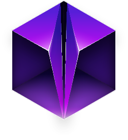
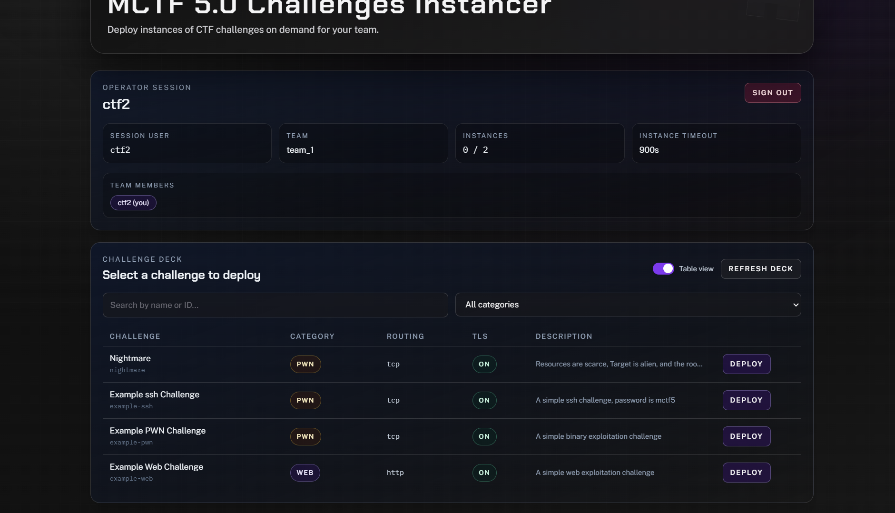
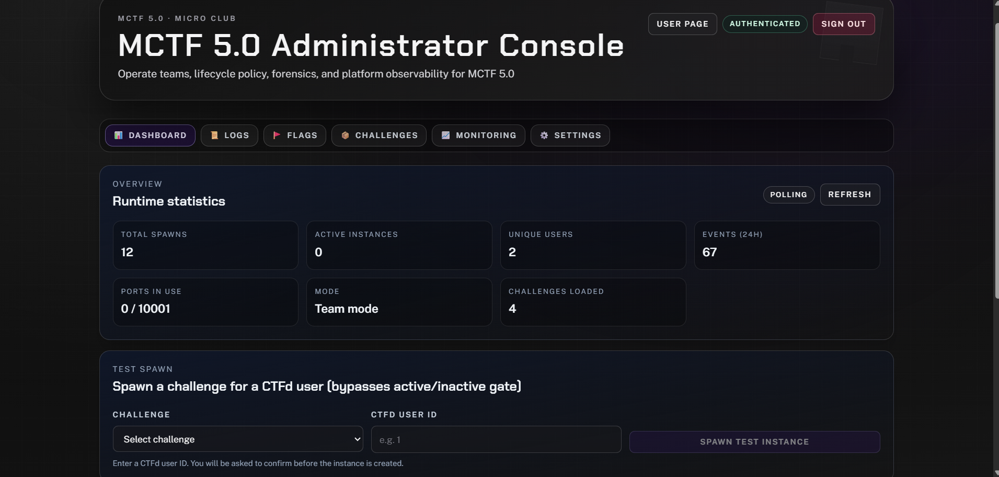
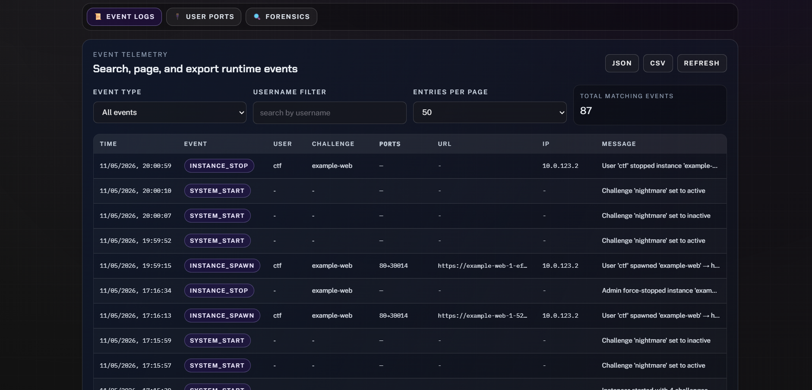
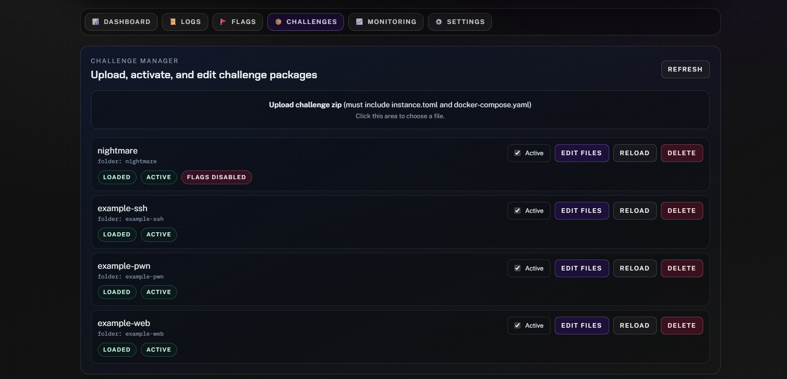
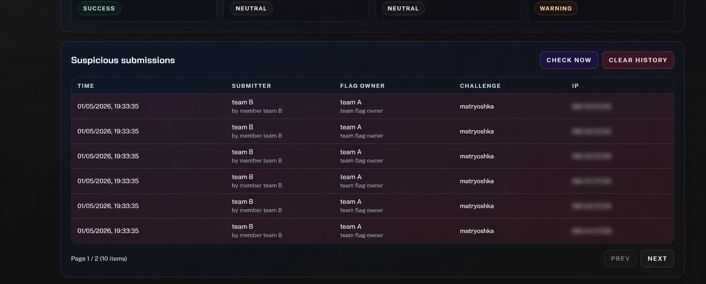
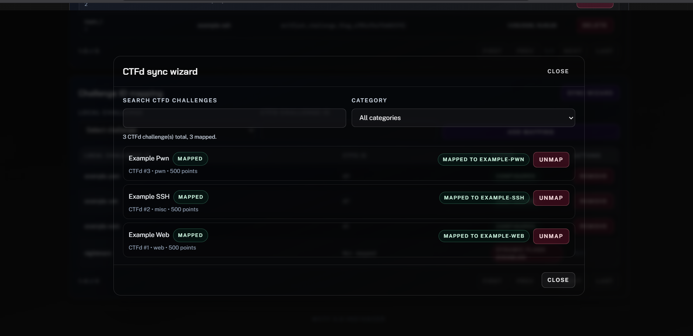

<h1 align="center"> MCTF Instancer</h1>
<h3 align="center">Dedicated Docker Instancer for CTF Competitions</h3>

<p align="center">
  <strong>Maintained by <a href="https://github.com/MicroClub-USTHB">MicroClub-USTHB</a></strong><br>
  <sub>Fork of <a href="https://github.com/jonscafe/whaley">jonscafe/whaley</a> — heavily customized for MCTF 5.0</sub>
</p>

<p align="center">
  <a href="#-features">Features</a> •
  <a href="#-quick-start">Quick Start</a> •
  <a href="#-documentation">Documentation</a> •
  <a href="#-screenshots">Screenshots</a> •
  <a href="#-contributing">Contributing</a>
</p>

---

## 📋 Overview

**MCTF Instancer** is a production-ready Docker instance manager purpose-built for **MCTF 5.0**, the flagship cybersecurity competition of [MICRO CLUB](https://github.com/MicroClub-USTHB). It provides each CTF participant with their own isolated challenge environment — complete with automatic port allocation, resource limits, dynamic Traefik routing, and CTFd integration with anti-cheat.

This is a fork of [jonscafe/whaley](https://github.com/jonscafe/whaley), extensively reworked for production-grade MCTF 5.0 operations. See [what we changed](#-what-we-built-on-top) for the full list of additions.

### Why MCTF Instancer?

| Problem | Solution |
|---------|-------------------|
| Shared challenge instances cause interference | 🔒 **Isolated containers** per user/team |
| Manual reverse-proxy updates are error-prone | 🌐 **Dynamic Traefik routers via Redis KV** |
| No visibility into player resource usage | 📊 **Real-time monitoring** dashboard |
| Difficult to detect flag sharing | 🔍 **Incremental suspicious submission detection** with dedup |
| Complex setup for dynamic flags | 💉 **Auto flag generation** — extract base, append hash, inject everywhere |

---

## ✨ Features

<table>
<tr>
<td width="50%" valign="top">

### 🚀 Core
- **Dynamic Instance Spawning** — Isolated Docker containers per user/team
- **Subdomain-Per-Instance Routing** — `https://<instanceId>.ctf.example` for HTTP, SNI for TCP
- **Traefik Redis KV Provider** — Routers/services written/removed at runtime
- **Multi-Port Challenges** — Support for complex multi-service challenges
- **Auto-Cleanup** — Instances terminated on timeout, background orphan sweep
- **Enforced Resource Limits** — Memory, CPU, PID caps on every container
- **Per-Challenge Overrides** — Fine-tune limits per challenge from admin panel

### 🔐 Security
- **CTFd Integration** — Validate users via CTFd access tokens
- **No-Auth Mode** — IP-based identification for open events
- **Network Isolation** — Each instance in its own Docker bridge network
- **Distributed Locking** — Redis-based locks (asyncio fallback for single-worker)
- **Fork Bomb Protection** — PID limits per container

</td>
<td width="50%" valign="top">

### 🚩 Dynamic Flags & Anti-Cheat
- **Unique Per-Owner Flags** — `FLAG{base_content_<unique_hash>}` per user/team
- **Base Extraction** — Preserves original flag text, appends unique suffix
- **Auto File Injection** — Replaces all `FLAG{...}` occurrences in challenge files
- **CTFd Registration** — Flags auto-registered in CTFd at spawn time
- **Incremental Submission Scanning** — Checks only new CTFd submissions every 60s
- **SHA-256 Deduplication** — Same incident never recorded twice
- **Full-Scan Mode** — On-demand complete audit via admin API
- **Database-Backed** — All flag data in SQLite/PostgreSQL, no JSON bloat

### 📊 Admin & Operations
- **Real-Time Monitoring** — Live CPU/RAM per container and per instance
- **Instance Forensics** — Auto-capture logs on terminate, live-capture on demand
- **React Admin Panel** — 6-tab SPA: Dashboard, Logs, Flags, Challenges, Monitoring, Settings
- **Challenge Manager** — Upload, edit, toggle, and manage challenges via web UI
- **Runtime Settings UI** — Change 30+ settings without editing files or restarting
- **Discord Notifications** — Rich embeds for spawn/stop/extend/failure events
- **Prometheus Metrics** — 30+ metric families for SLO tracking
- **Event Logging** — Full audit trail in database

</td>
</tr>
</table>

---

## 🚀 Quick Start

### Prerequisites

- Docker Engine 24.0+ with Docker Compose v2
- 4+ CPU cores, 8GB+ RAM (see [capacity planning](./docs/DOCUMENTATION.md#capacity-planning))
- Linux server (Ubuntu 22.04+ or Debian 12+ recommended)

### Installation

```bash
git clone https://github.com/MicroClub-USTHB/mctf-instancer.git
cd mctf-instancer
cp .env.example .env
nano .env  # Set ADMIN_KEY, CTFD_URL, TRAEFIK_BASE_DOMAIN, etc.
docker compose up -d
```

### Access Points

| Interface | URL | Description |
|-----------|-----|-------------|
| **User Dashboard** | `http://your-server:8000/` | Challenge spawning (React SPA) |
| **Admin Panel** | `http://your-server:8000/admin` | Monitoring & management (React SPA) |
| **API Docs** | `http://your-server:8000/docs` | Swagger API documentation |

---

## ⚙️ Essential Configuration

```env
# Authentication
AUTH_MODE=ctfd                     # "ctfd" or "none"
CTFD_URL=https://your-ctfd.com
CTFD_API_KEY=ctfd_xxx...           # Required for dynamic flags + team detection

# Routing (Traefik Redis KV)
TRAEFIK_REDIS_URL=redis://redis:6379/0
TRAEFIK_BASE_DOMAIN=ctf.example
TRAEFIK_BACKEND_HOST=challenges-vm
TRAEFIK_TCP_EXTERNAL_PORT=5443
PORT_RANGE_START=20000
PORT_RANGE_END=50000

# Admin
ADMIN_KEY=your-secure-key          # Generate: openssl rand -hex 32
METRICS_SECRET=your-metrics-key    # Bearer auth for /metrics

# Dynamic Flags (requires AUTH_MODE=ctfd + CTFD_API_KEY)
DYNAMIC_FLAGS_ENABLED=true
FLAG_PREFIX=FLAG

# Team Mode
TEAM_MODE=auto                     # "auto", "enabled", or "disabled"
```

> **Full configuration reference:** [docs/DOCUMENTATION.md](./docs/DOCUMENTATION.md#configuration) — 40+ environment variables documented.

---

## 📁 Challenge Structure

```
challenges/
└── my-web-challenge/
    ├── instance.toml          # Challenge metadata (id, type, ports, timeout)
    ├── docker-compose.yaml    # Container definition
    ├── Dockerfile
    ├── flag.txt               # FLAG{placeholder} — auto-injected at spawn
    └── src/
        └── app.py
```

**instance.toml example:**
```toml
id = "my-web-challenge"
name = "SQL Injection Lab"
category = "web"
type = "http"
ports = [80]
timeout = 3600
extend_time = 1800
```

> **Full challenge authoring guide:** [docs/DOCUMENTATION.md](./docs/DOCUMENTATION.md#challenge-structure)

---

## 👥 Team Mode

| Feature | User Mode | Team Mode |
|---------|:---------:|:---------:|
| Instance Ownership | Per user | Per team (shared) |
| Dynamic Flags | Unique per user | Shared per team |
| Instance Control | Only spawner | Any team member |
| Suspicious Detection | User vs User | Team vs Team |

Enable with `TEAM_MODE=auto` to auto-detect from CTFd settings.

---

## 📖 Documentation

| Document | Audience | Content |
|----------|----------|---------|
| **[DOCUMENTATION.md](./docs/DOCUMENTATION.md)** | CTF organizers, admins | Installation, configuration, challenge authoring, API reference, admin usage, capacity planning, environment variables reference |
| **[ARCHITECTURE.md](./docs/ARCHITECTURE.md)** | Developers, maintainers | Code structure, module descriptions, data flows, persistence design, cleanup lifecycle, security model, metrics |
| **[DYNAMIC-FLAGS.md](./docs/DYNAMIC-FLAGS.md)** | Developers, power users | Deep-dive on flag extraction, generation, injection, and suspicious submission detection pipeline |

---

## 📸 Screenshots

<table>
<tr>
<td align="center" width="50%">

<br><b>User Dashboard</b>
</td>
<td align="center" width="50%">

<br><b>Admin Dashboard</b>
</td>
</tr>
<tr>
<td align="center">

<br><b>Event Logs</b>
</td>
<td align="center">

<br><b>Challenge Manager</b>
</td>
</tr>
<tr>
<td align="center">

<br><b>Dynamic Flags</b>
</td>
<td align="center">

<br><b>CTFd Challenge Sync</b>
</td>
</tr>
</table>

---

## 📊 Capacity Planning

| Event Size | CPU | RAM | Storage | Example |
|------------|:---:|:---:|:-------:|---------|
| **Small** (≤50 teams) | 4 cores | 8 GB | 40 GB SSD | Local CTFs |
| **Medium** (50–150 teams) | 8 cores | 32 GB | 100 GB SSD | University CTFs |
| **Large** (150–300 teams) | 16 cores | 64 GB | 200 GB SSD | National CTFs |

> Detailed formulas and per-type resource recommendations: [docs/DOCUMENTATION.md](./docs/DOCUMENTATION.md#capacity-planning)

---

## 🤝 Contributing

Contributions welcome! Fork → feature branch → PR.

---

## 📄 License

MIT License — see [LICENSE](LICENSE).

---

## 🧬 What We Built on Top

This project is a fork of **[jonscafe/whaley](https://github.com/jonscafe/whaley)** by **keii** — a huge thank you for the solid foundation. The original already handled the core Docker lifecycle (spawn/stop/extend), CTFd authentication with user and team modes, rate limiting, distributed locking, network isolation, resource enforcement, basic monitoring and forensics, and event logging.

Here is what MicroClub built on top for MCTF 5.0:

### New Systems (did not exist in the original)

| Addition | Description |
|---|---|
| **Traefik Redis KV routing** | Entirely new. Replaced direct port export with dynamic SSL-terminated domain-based routing. Per-instance HTTP routers (`Host` rule) and TCP SNI routers, written to Redis at runtime and consumed by an external Traefik instance. |
| **React + Vite frontend** | Replaced the original plain HTML/vanilla-JS UI with a full React 18 + TypeScript SPA. Two separate entry points: user dashboard and 6-tab admin panel (Dashboard, Logs, Flags, Challenges, Monitoring, Settings). |
| **instance.toml config system** | Replaced the original YAML-based challenge config with a TOML schema. Added `connection_command` templates, `entrypoint`, `tls_options`, `routing_type`, and per-category command overrides. |
| **Discord webhook notifications** | Rich embed notifications for spawn, stop, extend, and spawn-failure events with instance details, routing info, and team context. |
| **Prometheus metrics endpoint** | 30+ metric families: instance counts by status/owner/team/challenge, spawn latency histogram, runtime operation counters, port pool utilization, flag assignment totals, suspicious submission counts. Protected by `METRICS_SECRET` Bearer token. |
| **Runtime Settings UI** | Admin panel tab to edit 30+ Instancer settings at runtime (no file edits or restarts). Changes persist to the database and survive container restarts. Type-aware inputs, override/default badges, change tracking. |


### Reworked Systems (significantly changed from the original)

| Change | Description |
|---|---|
| **Dynamic flags** | Changed from fully random `FLAG{<32 hex>}` to base-extraction + hash-suffix: `FLAG{original_text_<unique_16hex>}`. Moved persistence from a single JSON file (which ballooned to 500MB from duplicate entries) to database tables with proper indexing. |
| **Anti-cheat detection** | Added incremental scanning with `last_submission_id` checkpoint (only checks new CTFd submissions, no repeated re-scanning). SHA-256 deduplication key (`hash(submitter\|owner\|flag)`). Full-scan mode available via admin API. Suspicious submissions paginated from DB. |
| **Resource cleanup** | Multi-level orphan sweep: per-instance synchronous teardown (compose down, network removal, per-spawn image deletion), background sweep every ~10 min with 5-min safety window, startup stale-project discovery and cleanup. |
| **Port allocation** | Extended with lane-based deterministic allocation (Blake2b hash), scavenger port verification via `socket.bind()`, and retry logic on conflicts. |

### Fixes & Stability

Numerous bug fixes and hardening throughout: race conditions in spawn/stop critical sections, cleanup gaps (orphan networks, dangling per-spawn images), duplicate flag entry proliferation, `_load_mappings` concurrency issues causing data loss, missing `await` on async logger calls dropping event log entries, and cross-line regex corruption from unclosed flag braces.

---

<p align="center">
  <strong>Maintained with ❤️ by <a href="https://github.com/MicroClub-USTHB">MICRO CLUB</a></strong><br>
  <sub>Powered by <a href="https://github.com/jonscafe/whaley">Whaley</a> — the original CTF Docker instancer</sub>
  <br><br>
  <a href="https://github.com/MicroClub-USTHB/mctf-instancer">
    
  </a>
</p>
