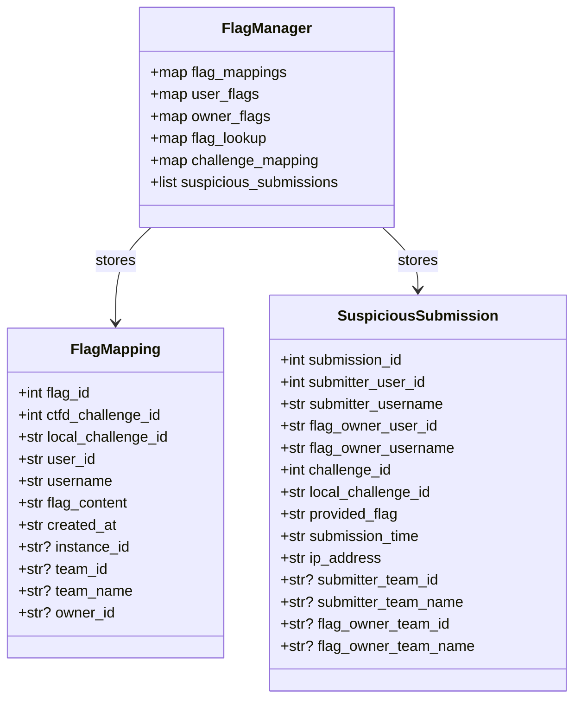
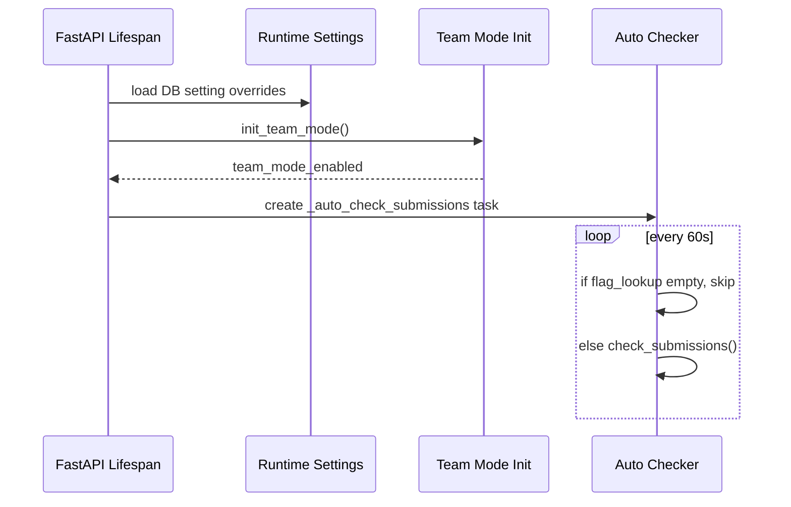
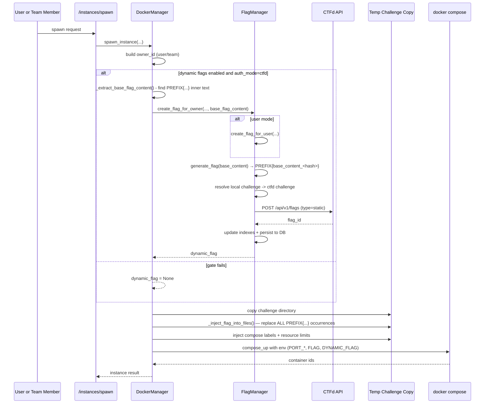
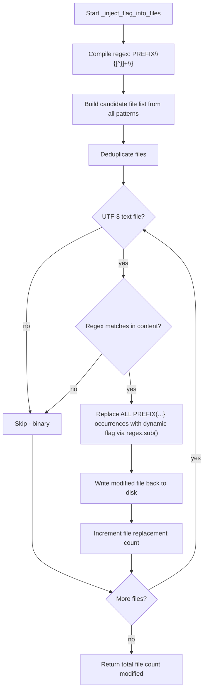
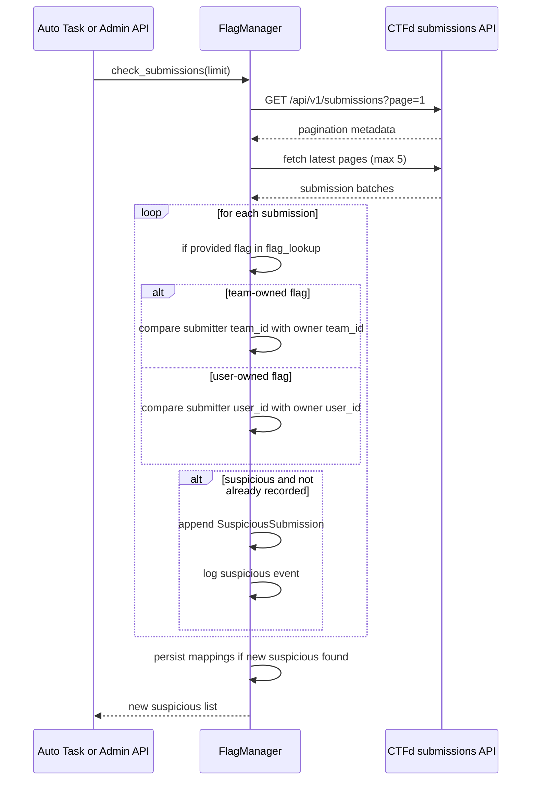

# Dynamic Flags in Whaley

This document explains exactly how dynamic flags work in this repository, based on the current implementation.

## Scope

This covers:
- flag generation and CTFd registration
- file and environment injection during spawn
- owner semantics in user mode vs team mode
- suspicious submission detection loop
- admin APIs for mapping, inspection, and cleanup
- state and persistence boundaries
- implementation caveats and operational gotchas

Primary implementation files:
- [app/flag_manager.py](app/flag_manager.py)
- [app/docker_manager.py](app/docker_manager.py)
- [app/main.py](app/main.py)
- [app/auth.py](app/auth.py)
- [app/config.py](app/config.py)

## 1. Preconditions and Feature Gates

Dynamic flags are only attempted when all of these are true:
1. `DYNAMIC_FLAGS_ENABLED` is true in runtime settings ([app/config.py](app/config.py#L78), [.env.example](.env.example#L104)).
2. auth mode is CTFd (`AUTH_MODE == "ctfd"`) ([app/docker_manager.py](app/docker_manager.py#L686)).
3. CTFd URL and API key are present when creating/checking flags ([app/flag_manager.py](app/flag_manager.py#L183), [app/flag_manager.py](app/flag_manager.py#L301), [app/flag_manager.py](app/flag_manager.py#L424)).
4. local challenge id is mapped to a CTFd challenge id ([app/flag_manager.py](app/flag_manager.py#L139)).

Flag format is `PREFIX{<base_content>_<16 hex chars>}` where:
- `base_content` is the inner text extracted from the first `PREFIX{...}` placeholder found in challenge files (see §5.1)
- If no placeholder is found, a fully random 32-hex-char flag is generated: `PREFIX{<32 hex chars>}`
- Prefix is `FLAG_PREFIX` (default `FLAG`)

Code: `generate_flag()` in [app/flag_manager.py](app/flag_manager.py#L186), `_extract_base_flag_content()` in [app/docker_manager.py](app/docker_manager.py#L909).

## 2. Runtime Components

| Component | Responsibility | Key Entry Points |
|---|---|---|
| `FlagManager` | create, index, persist, and check flags | [app/flag_manager.py](app/flag_manager.py#L52) |
| `DockerManager` | spawn lifecycle and injection before compose up | [app/docker_manager.py](app/docker_manager.py#L564) |
| app lifespan task | periodic auto-check of submissions | [app/main.py](app/main.py#L248), [app/main.py](app/main.py#L320) |
| admin APIs | mapping/check/list/delete operations | [app/main.py](app/main.py#L979) |
| CTFd | stores static flags and submissions | CTFd API calls in [app/flag_manager.py](app/flag_manager.py#L206), [app/flag_manager.py](app/flag_manager.py#L439) |

## 3. Data Model and Indexes

`FlagManager` stores several in-memory indexes loaded from and persisted to the database.

Mermaid class diagram:

Persistence path:
- Database tables: `flag_mappings`, `challenge_mapping` (stored in `whaley_settings`), `suspicious_submissions`
- In-memory indexes (`flag_lookup`, `user_flags`, `owner_flags`, `challenge_mapping`) are loaded from DB at startup for fast lookups during submission checking
- The legacy `logs/flag_mappings.json` file is no longer used

Saved fields are read from DB at startup via `FlagManager.initialize()` and written on every mutation.

## 4. Startup and Background Loop

At startup:
1. DB and lock infrastructure init.
2. settings overrides loaded from DB.
3. team mode initialized.
4. background submission checker task started.
5. `FlagManager.initialize()` is called lazily on first access — loads flag mappings, challenge mapping, suspicious unique keys, and last submission checkpoint from database.

The background checker now uses **incremental mode**: it tracks the highest `submission_id` processed in `whaley_settings.last_submission_id` and only checks new submissions since that checkpoint. This avoids re-scanning the same 250 submissions every 60s. A full scan can be triggered via the admin API with `full_scan=true`.

Mermaid sequence:

## 5. Spawn-Time Flag Creation and Injection

The user entrypoint is `POST /instances/spawn` ([app/main.py](app/main.py#L488)).

Detailed sequence:

Core implementation anchors:
- dynamic flag gate and create call: [app/docker_manager.py](app/docker_manager.py#L686), [app/docker_manager.py](app/docker_manager.py#L690)
- create for user/team: [app/flag_manager.py](app/flag_manager.py#L173), [app/flag_manager.py](app/flag_manager.py#L267)
- CTFd flag create endpoint: [app/flag_manager.py](app/flag_manager.py#L206), [app/flag_manager.py](app/flag_manager.py#L325)
- CTFd payload metadata:
  - user mode `data`: [app/flag_manager.py](app/flag_manager.py#L215)
  - team mode `data`: [app/flag_manager.py](app/flag_manager.py#L334)
- temp copy and injection path: [app/docker_manager.py](app/docker_manager.py#L1061), [app/docker_manager.py](app/docker_manager.py#L1070), [app/docker_manager.py](app/docker_manager.py#L1076)
- env injection: [app/docker_manager.py](app/docker_manager.py#L1120), [app/docker_manager.py](app/docker_manager.py#L1121), [app/docker_manager.py](app/docker_manager.py#L1122)

### 5.1 Base Flag Content Extraction

Before creating a dynamic flag, Whaley extracts the base content from any existing placeholder flag in the challenge files. This allows the dynamic flag to **preserve** the original flag's inner text while appending a unique hash suffix.

`_extract_base_flag_content()` scans challenge files with a priority order:

1. **Dedicated flag files** — `flag`, `flag.txt` (root only)
2. **Config files** — `docker-compose.yaml`, `docker-compose.yml`, `Dockerfile` (root only)
3. **Source files** — recursive scan for `*.py`, `*.js`, `*.php`, `*.html`, `*.txt`, `*.sh`, `*.env`, `*.c`, `*.cpp`, `*.go`

It uses the regex `PREFIX{([^}]+)}` (case-insensitive) to match the **inner content** between the braces. The first match found is returned (without prefix and braces).

**Example:**
- Challenge file contains: `FLAG{th1s_1s_th3_fl4g}`
- Extracted base content: `th1s_1s_th3_fl4g`
- Dynamic flag generated: `FLAG{th1s_1s_th3_fl4g_a1b2c3d4e5f6g7h8}`

If no placeholder flag is found, `None` is returned and `generate_flag()` falls back to a fully random 32-hex-char flag: `FLAG{<32 random hex chars>}`.

Code: [app/docker_manager.py](app/docker_manager.py#L909), [app/flag_manager.py](app/flag_manager.py#L186).

### 5.2 Owner Semantics (User vs Team)

Owner id differs by mode:
- user mode: owner id = user id
- team mode: owner id = team id

This affects:
- flag reuse lookup (`user_flags` vs `owner_flags`)
- anti-cheat comparison basis
- spawn ownership and limits

Team mode detection path:
- `init_team_mode()` in [app/auth.py](app/auth.py#L201)
- CTFd mode detection in [app/auth.py](app/auth.py#L28)

### 5.3 Challenge Mapping Resolution

`get_ctfd_challenge_id` logic:
1. exact key lookup
2. case-insensitive lookup
3. reload persisted mappings from DB and retry exact + case-insensitive
4. return `None` with guidance if missing

Code: [app/flag_manager.py](app/flag_manager.py#L139), [app/flag_manager.py](app/flag_manager.py#L151), [app/flag_manager.py](app/flag_manager.py#L156), [app/flag_manager.py](app/flag_manager.py#L169).

### 5.4 File Injection Algorithm

`_inject_flag_into_files` scans all challenge files and replaces **every** occurrence of `PREFIX{...}` with the dynamic flag.

**Regex pattern:** `PREFIX{[^}\n]+}` — case-insensitive prefix match, with `\n` excluded from the inner match to prevent the regex from bridging across lines when a flag template is missing its closing brace (an unclosed `FLAG{` would otherwise match forward into any later `}` in the file, corrupting unrelated source like `${some_var}` in bash scripts).

**Replacement behavior:** `flag_pattern.sub(dynamic_flag, content)` — **all** occurrences of the pattern in a file are replaced with the full dynamic flag string. For example, if a file contains both `FLAG{placeholder}` and `FLAG{another}`, both are replaced with the same `FLAG{th1s_1s_th3_fl4g_a1b2c3d4e5f6g7h8}`.

**Scan scope includes:**
- `flag`, `flag.txt` (root and recursive)
- `flag-*`, `flag_*`, `*.flag` (recursive glob)
- Root config: `docker-compose.yaml`, `docker-compose.yml`, `Dockerfile`
- Recursive config: `Dockerfile`, `docker-compose.yml`, `docker-compose.yaml` in subdirectories
- Recursive source extensions: `*.py`, `*.js`, `*.php`, `*.html`, `*.txt`, `*.sh`, `*.env`, `*.c`, `*.cpp`, `*.go`

Files are deduplicated before processing. Binary files (UnicodeDecodeError) are skipped. Only files where the regex matches are written back. The return value is the count of **files modified** (not individual replacements within files).

Code: [app/docker_manager.py](app/docker_manager.py#L940).

Mermaid flowchart:

## 6. Suspicious Submission Detection

There are two trigger paths:
1. automatic background loop every 60 seconds ([app/main.py](app/main.py#L248), [app/main.py](app/main.py#L259), [app/main.py](app/main.py#L263))
2. manual admin trigger `POST /admin/api/flags/check-submissions` ([app/main.py](app/main.py#L992), [app/main.py](app/main.py#L1003))

### 6.1 Detection Sequence

### 6.2 Matching and Decision Rules

Matching key:
- submission `provided` value must exactly match a tracked dynamic flag in `flag_lookup` ([app/flag_manager.py](app/flag_manager.py#L510)).

Collection window:
- reads page 1 for pagination, then fetches newest pages up to 5 pages max (`<= 250` rows before `limit`) ([app/flag_manager.py](app/flag_manager.py#L472), [app/flag_manager.py](app/flag_manager.py#L474), [app/flag_manager.py](app/flag_manager.py#L495)).

Comparison logic:
- user mode: suspicious if `submitter_user_id != flag_owner_user_id`
- team mode: suspicious if submitter team id differs from owner team id; also suspicious when team flag is submitted by a non-team submitter path

Decision code branch: [app/flag_manager.py](app/flag_manager.py#L571).

Deduplication:
- by `submission_id`, only new ids are appended to `suspicious_submissions` ([app/flag_manager.py](app/flag_manager.py#L625)).

Persistence after detection:
- saves only when new suspicious records were added ([app/flag_manager.py](app/flag_manager.py#L650)).

## 7. Admin API Surface for Dynamic Flags

Dynamic-flag admin endpoints are in [app/main.py](app/main.py#L979):

| Endpoint | Method | Behavior |
|---|---|---|
| `/admin/api/flags` | GET | full flags state summary and config status |
| `/admin/api/flags/check-submissions` | POST | run detection now |
| `/admin/api/flags/suspicious` | GET | list suspicious entries |
| `/admin/api/flags/suspicious` | DELETE | clear suspicious list |
| `/admin/api/flags/mappings` | GET | list mapping rows (includes `flag_content`) |
| `/admin/api/flags/user/{user_id}` | DELETE | delete all flags for one user |
| `/admin/api/flags/{flag_id}` | DELETE | delete one flag mapping |
| `/admin/api/flags/sync-challenge` | POST | map local challenge id to CTFd challenge id |
| `/admin/api/flags/mapping/{local_challenge_id}` | DELETE | remove mapping |
| `/admin/api/ctfd/challenges` | GET | fetch CTFd challenges with mapping suggestions |

## 8. Current Behavior Notes and Caveats

These are implementation-backed caveats from the current code.

1. Spawn is fail-open for flag creation.
- If dynamic flag creation fails, spawn can still proceed (`dynamic_flag` stays `None`).
- Evidence: [app/docker_manager.py](app/docker_manager.py#L708), [app/docker_manager.py](app/docker_manager.py#L750).

2. Flags are reused per owner+challenge, not regenerated per instance.
- user mode reuse via `user_flags` lookup
- team mode reuse via `owner_flags` lookup
- Evidence: [app/flag_manager.py](app/flag_manager.py#L188), [app/flag_manager.py](app/flag_manager.py#L307).

3. Flag deletion is admin-driven; no automatic delete on instance stop/expire path.
- cleanup helpers exist in admin API and `cleanup_user_flags`
- no stop/expiry hook to remove CTFd flags by default
- Evidence: [app/main.py](app/main.py#L1079), [app/flag_manager.py](app/flag_manager.py#L684).

4. Prefix consistency matters for replacement.
- replacement only targets `FLAG_PREFIX{...}`-style text
- examples are currently mixed:
  - web example uses `mctf{...}` in compose ([challenges/example-web/docker-compose.yaml](challenges/example-web/docker-compose.yaml#L9))
  - pwn example uses `CTF{...}` ([challenges/example-pwn/docker-compose.yaml](challenges/example-pwn/docker-compose.yaml#L9))
- default prefix is `FLAG` unless changed ([.env.example](.env.example#L107)).

5. Logging calls in `FlagManager` are invoked without `await`.
- `event_logger.log_flag_created(...)` and `event_logger.log_suspicious_submission(...)` are async logger methods called synchronously.
- Evidence call sites: [app/flag_manager.py](app/flag_manager.py#L248), [app/flag_manager.py](app/flag_manager.py#L377), [app/flag_manager.py](app/flag_manager.py#L631).

6. Admin mappings endpoint includes raw `flag_content`.
- Useful for operations, but sensitive if admin surface is overexposed.
- Evidence: [app/main.py](app/main.py#L1068).

## 9. Practical Checklist to Make Dynamic Flags Work Reliably

1. Set runtime config:
- `AUTH_MODE=ctfd`
- `CTFD_URL` and `CTFD_API_KEY`
- `DYNAMIC_FLAGS_ENABLED=true`
- `FLAG_PREFIX` matching your placeholder convention

2. Map local challenge ids to CTFd challenge ids:
- use `POST /admin/api/flags/sync-challenge` or sync wizard data from `GET /admin/api/ctfd/challenges`

3. Author challenge placeholders consistently:
- use placeholder text with your configured prefix in files that are scanned/replaced
- or use compose interpolation form `FLAG=${FLAG}` as documented ([README.md](README.md#L213))

4. Verify end-to-end:
- spawn instance
- inspect `/admin/api/flags` state
- run `/admin/api/flags/check-submissions`
- verify suspicious records and event logs

## 10. End-to-End Summary

Dynamic flags in Whaley are implemented as a coordinated pipeline:
1. spawn request enters `DockerManager`
2. `_extract_base_flag_content()` scans challenge files for an existing `PREFIX{...}` placeholder and extracts the inner text (the "base content")
3. `FlagManager.generate_flag()` creates a unique flag by appending `_<16 random hex>` to the base content: `PREFIX{base_content_<hash>}` (or a fully random 32-hex-char flag if no placeholder exists)
4. `FlagManager` registers the unique flag in CTFd and indexes it
5. `_inject_flag_into_files()` scans all challenge files and replaces **every** `PREFIX{...}` occurrence with the unique dynamic flag (regex uses `[^}\n]+` to avoid cross-line corruption from unclosed braces)
6. compose is started with `FLAG` and `DYNAMIC_FLAG` env vars also set to the dynamic flag
7. background and admin-triggered checks correlate CTFd submissions against known flag ownership
8. suspicious cross-owner submissions are recorded and persisted
